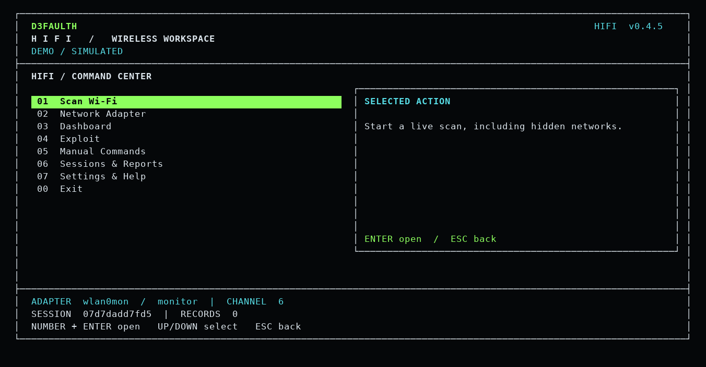
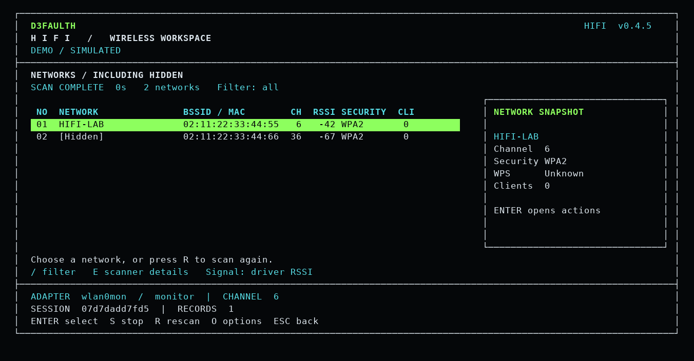
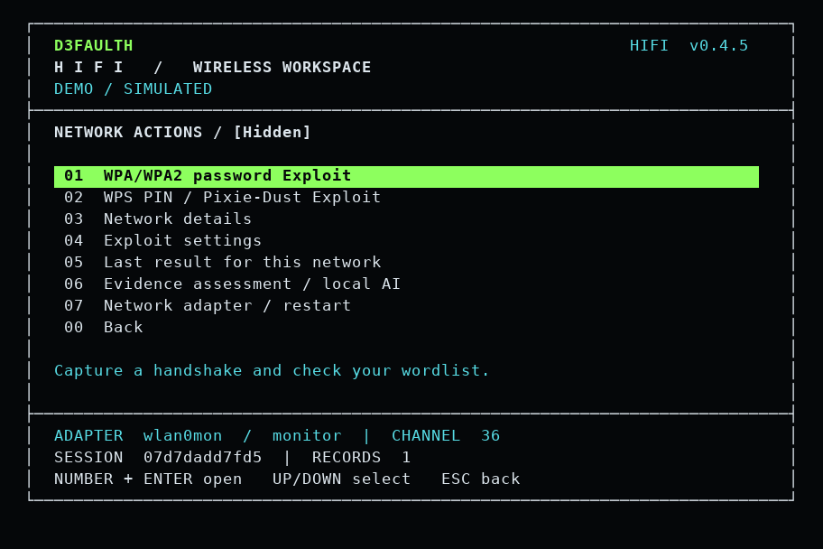
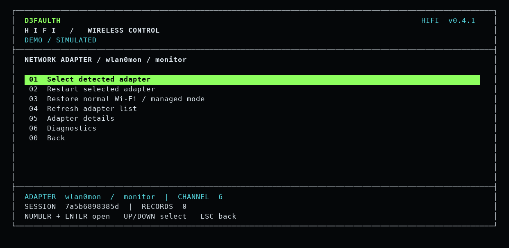
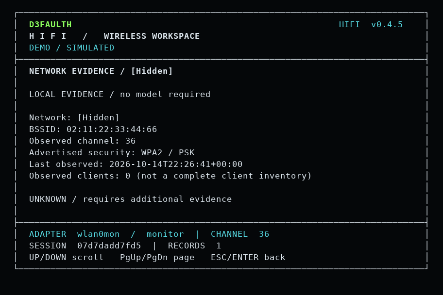

<div align="center">
  
  <p><strong>An interactive wireless Exploit toolkit with an integrated engine.</strong></p>
  <p>Python 3.10+ · Linux · GPL-2.0-only · 0.4.5 alpha</p>
</div>

**HIFI is the application.** Run `hifi` for its terminal menus, command editor,
wireless workflows, capture analysis, saved evidence and guided next steps.
Its engine ships inside the package; there is no separate engine application to
install or launch. External radio and password-processing backends remain
separate system tools.

**Status:** software-verified alpha. Physical adapter and live radio validation
remain pending. The engine has a pinned tagged baseline; its provenance,
modifications and inherited limitations are recorded in [credits](CREDITS.md).

## Install and run

From the cloned repository or extracted source folder on Kali/Debian:

```bash
sudo apt install pipx aircrack-ng iw iproute2
pipx install .
pipx ensurepath
```

Open a new terminal, then check the installation:

```bash
hifi --version
hifi doctor
hifi adapter list
```

**For live radio operations and adapter recovery, start the menu with root access:**

```bash
sudo "$(command -v hifi)"
```

The full launcher path keeps the Python environment installed by pipx. Plain
`hifi` opens the same interface as a normal user for diagnostics, reports and
help. The header shows the current privilege level; operations that need root
explain the relaunch command before starting a process.

To explore without changing any adapter:

```bash
hifi --demo
```

To update an existing pipx installation from a new source folder:

```bash
pipx install --force .
```

Python dependencies are installed with the package. System binaries and drivers
remain separate; `hifi doctor` lists what is available. A supported USB Wi-Fi
adapter must be passed through to Kali when using VMware. The source ZIP also
includes `hifi.pyz`; its demo works without installation, while live use requires
the declared Python dependencies and system backends.

## D3FAULTH terminal



The interface uses an original D3FAULTH wordmark, HIFI panel, black background,
green selection bar, cyan status text and numbered actions. Type a number and
press Enter, or use arrow keys and Enter. Main actions fit an 80×24 terminal.
Smaller windows show a resize message. The status area identifies the selected
adapter, last-read mode, session and command count.

| Main menu | Action |
| --- | --- |
| 01 | Scan Wi-Fi: start live discovery, including hidden networks |
| 02 | Network Adapter: selection, diagnostics, restart and recovery |
| 03 | Dashboard: session scope, overview and guidance |
| 04 | Exploit: actions for the selected network; advanced engine when none is selected |
| 05 | Manual Commands: choose a profile and edit its arguments |
| 06 | Sessions & Reports: history, notes and exports |
| 07 | Settings & Help: dependencies, keyboard and CLI reference |
| 00 | Exit and save the session |

Submenus use **00 Back**. Each main selection has a short explanation; all eight
entries fit at 80×24. See the agreed [D3FAULTH terminal standard](docs/TERMINAL_STANDARD.md).

## Hidden-network discovery

Choose **01 Scan Wi-Fi**, or just press Enter on the home screen.
HIFI selects the only connected adapter automatically; with multiple adapters,
it asks you to choose one unless a connected adapter is already selected.
No BSSID, channel or command entry is needed.
This is a live, passive scan on the selected adapter using `airodump-ng`.
It does not read NetworkManager's old network cache.



The table shows a stable row number, network name or **[Hidden]**, BSSID/MAC,
channel, driver-reported RSSI, security and observed client count. Press Enter
on a row (or type its number and Enter) to stop scanning, restore the adapter,
save that network's BSSID/channel in the session scope and open **Network Actions**.
Choose **03 Network details** to inspect the observation.
Details include cipher, authentication, derived frequency, timestamps, packet
counts and observed client MACs. WPS remains **Unknown** because the CSV source
does not report it. Signal is not falsely converted to percent or labelled dBm
without knowing the driver's units.

Hidden access points can be detected without learning their names. HIFI updates
the same row when observed traffic reveals the SSID; a blank later observation
does not erase an already observed name. Name recovery is not guaranteed. This
discovery feature never sends deauthentication frames or guesses hidden names.

- **S** stops the scan and keeps its observations on screen.
- **/** filters by name, BSSID or security; **Escape** returns.
- **R** restores the adapter and starts a fresh scan.
- **O** stops scanning and opens optional band/duration, adapter and saved-table controls.
- **E** shows the scanner exit code, error output and collected adapter checks.
- A failed backend is labelled **SCAN FAILED**. A readable scan with zero access
  points is labelled **NO NETWORKS RECEIVED**, with retry/settings guidance.
- Unknown channels are shown as **?**; the detected AP remains visible, but cannot
  be selected until a channel is observed.
- Saved observations are historical; check each network's last-seen timestamp.

Monitor mode temporarily interrupts the selected adapter's normal connection.
HIFI records its prior mode, link state and NetworkManager ownership, then
attempts restoration on completion, selection or cancellation. Other adapters
and the NetworkManager service are not restarted. Recovery errors are displayed
and recorded; after an unplug, crash or forced termination, use the adapter
recovery menu and inspect the saved `adapter-recovery.json` in the session folder.
This file is recovery evidence, not an automatic startup recovery script.

Requires root, `iw`, `ip` and `airodump-ng`; `nmcli` is used when NetworkManager
owns the selected device. The demo contains explicitly synthetic visible and
hidden networks and runs no radio commands. 6 GHz discovery is not supported by
this scan profile. Physical RTL8814AU/VMware validation remains pending.

## Selected-network Exploit workflow

**01 Scan Wi-Fi → choose a network → Network Actions** is the primary path.
The selected adapter, BSSID and channel carry into each workflow. **04 Exploit**
also reopens actions for the currently selected network.

| Network action | Behavior |
| --- | --- |
| 01 WPA/WPA2 password Exploit | Ask for a local text wordlist, capture a handshake and run the existing password-recovery workflow |
| 02 WPS PIN / Pixie-Dust Exploit | Run the existing WPS workflows when the engine observes usable WPS |
| 03 Network details | Show the selected observation and clients |
| 04 Exploit settings | Choose wordlist, overall time limit and WPA client-disconnect behavior |
| 05 Last result | Show this network's last attempt and recovery evidence |
| 00 Back | Return to the network table |



Each attempt has a command preview. Enter starts it; Escape returns. During an
attempt, the D3FAULTH frame stays visible with the selected network, adapter
mode, elapsed time and live engine output. Escape stops the process group and
attempts adapter restoration. Completion returns to a result page and then
Network Actions; this path does not hand the terminal over to the engine.

The default overall time limit is **600 seconds**, adjustable from 30 to 86400.
WPA client disconnects are allowed by default and stated in the preview; switch
them off in Exploit settings for passive capture. WPS uses active WPS requests
and does not enable deauthentication in this profile. Neither workflow selects
additional BSSIDs or inherits arguments saved in the advanced engine editor.

WPA/WPA2 needs a readable, uncompressed wordlist, plus `aircrack-ng`, `iw`,
`iproute2`, `tshark`, `hashcat` and `hcxtools`. WPS needs `aircrack-ng`, `iw`,
`iproute2`, `tshark`, `pixiewps`, and `reaver` or `bully`. Backend binaries,
drivers and Hashcat compute support must work on the host. Missing tools are
reported before monitor-mode changes. WPA3, enterprise, open and unknown
security types are rejected by these two selected-network profiles.

**A successful process exit is not reported as password recovery.** Each attempt
uses a fresh private directory; a recovered password or PIN must appear in that
attempt's structured result for the selected BSSID and workflow. PIN-only
results explicitly say the password was not recovered. Errors, time limits,
cancellation and restoration failures remain visible. Summary exports omit
credentials and target details; full private exports include them.

The discovery table's **WPS: Unknown** remains an observation limitation. It does
not mean WPS is enabled; the engine checks available WPS evidence when it runs.
Live password/PIN recovery and Hashcat compute compatibility on the user's Kali
VM remain unverified. Demo actions are clearly simulated and never claim recovery.

## Restart and restore the adapter

Choose **02 Network Adapter → Select detected adapter**, then **Restart selected adapter**.
HIFI previews the exact commands and affected interface. Restart brings that
interface down and up while retaining its current wireless mode.

**Restore normal Wi-Fi / managed mode** additionally returns a monitor interface
to managed mode. Both actions interrupt that adapter's connection. HIFI verifies
its resulting mode and administrative UP flag and records all command results.
A link-up recovery attempt runs even after a cancelled/failed link-down or mode
change. This is best-effort recovery; unplugged hardware, driver failures and
forced process termination can prevent it.



No other adapter or NetworkManager service is restarted. Reconnect through your
desktop network menu afterward. Link UP alone does not establish connectivity,
and restoring managed mode does not remove additional virtual interfaces or
restart a network service previously stopped by another workflow.

Equivalent CLI previews and execution:

```bash
hifi adapter list
hifi adapter restart --interface wlan0
sudo "$(command -v hifi)" adapter restart --interface wlan0 --run
sudo "$(command -v hifi)" adapter restart --interface wlan0 --restore-managed --run
```

Use an interface actually shown by `hifi adapter list`. Omitting `--run` displays
a plan without changing the adapter. Demo mode simulates these actions.

## Included features

| Capability | Behavior |
| --- | --- |
| Full HIFI Exploit | Integrated discovery, target selection, prompts and wireless workflows |
| WPA/WPA2 | Handshake capture, optional active deauthentication and dictionary recovery |
| WPS | PIN, Pixie-Dust and supported NULL PIN workflows through Reaver/Bully |
| PMKID | Capture, conversion and password recovery through supported backends |
| WEP | Retained replay, fragmentation, chop-chop and other baseline methods |
| Engine options | All 113 baseline option names and aliases retained; full help in the menu |
| Manual control | Editable engine arguments, analysis filters, file paths and diagnostic commands |
| Capture-only profiles | Separate bounded passive/active profiles, selected BSSID/interface/channel |
| Capture inspector | Metadata, EAPOL and disconnect-frame views; offline wordlist Exploit |
| Diagnostics | Adapter capabilities, interface state, radio blocks and backend inventory |
| Guided suggestions | Evidence-based rules and optional local Ollama explanation |
| Sessions | Private saved arguments, working directory, notes, history and terminal-output tail |
| Reports | HTML/JSON, with sensitive evidence omitted by default |

Recovery depends on network configuration, capture quality, dictionary candidates,
hardware and installed backends. A selector for WPA3/OWE is not a general recovery
method. Unimplemented legacy placeholders are not advertised as working features.
HIFI does not claim to outperform its upstream baseline.

## Terminal workflow

1. Open **02 Network Adapter → Diagnostics** and review dependencies.
2. Choose **04 Exploit → Full HIFI Exploit**.
3. Edit the engine command if needed, review it and run.
4. Select targets and respond to engine prompts. Ctrl+C reaches the current
   workflow; exit it to return to the HIFI menu.
5. Use **06 Sessions & Reports** for history, notes and exports. Choose **00 Exit** to save and return to the shell.

HIFI menu controls: arrows or `j/k`, Enter to select, Escape or `q` to return.
The editor supports Home/End, arrows, Backspace/Delete and Ctrl+U. Result views
support Page Up/Page Down. During the engine workflow, keys belong to the engine;
Escape is not a HIFI cancellation shortcut there.

Full Exploit mode uses its own target selection and timing. The scope/duration
shown in HIFI applies to its separate **capture-only** profiles. Those profiles
disable WPS, PMKID and cracking during capture; the full engine does not inject
those restrictions. Passive profiles also disable deauthentication.

## Commands

```bash
hifi --help
hifi --version
hifi doctor
hifi --demo
hifi engine --help
hifi engine --help -v
hifi exploit
hifi exploit --run
hifi --session SESSION_ID exploit
hifi --session SESSION_ID suggest
hifi inspect /absolute/path/capture.pcapng --view eapol
hifi --session SESSION_ID report --output summary.html
```

`hifi engine` is the direct engine entry point. Its flags follow `engine`.
`hifi exploit` adds command preview, a private workspace and HIFI history; its
engine flags follow `--`. Bare `hifi` opens the interactive menus.

See [usage](docs/USAGE.md) for saved arguments, directories and capture profiles.

## System tools and hardware

Install the backends needed for the workflows you use. A Kali starting set is:

```bash
sudo apt update
sudo apt install iw iproute2 rfkill usbutils network-manager ieee-data tshark wireshark-common aircrack-ng reaver bully pixiewps hcxtools hcxdumptool hashcat macchanger
hifi doctor
```

Some optional backends vary by distribution. `hifi doctor` lists binaries it can
find. Supply your own dictionary using the engine's `--dict` option; the package
does not ship a password list or silently download one. Vendor lookup uses the
system IEEE database or an explicitly requested update.

Live operations require a supported Wi-Fi adapter and suitable privileges.
In a VM, pass through a USB Wi-Fi adapter; virtual Ethernet does not provide
802.11 monitor frames. The standalone dumpcap profile needs an existing monitor
interface on the selected channel. The engine can manage monitor mode itself.
After a forced stop, verify interface state; terminal restoration does not imply
radio-interface restoration.

## Data and privacy

State defaults to `$XDG_STATE_HOME/d3faulth-hifi` or
`~/.local/state/d3faulth-hifi`; `--home` overrides it. New session directories are
0700 and JSON/reports are 0600. A session's `engine` subdirectory holds its native
files unless you choose an existing workspace. Relative engine file arguments
resolve in that workspace. Absolute capture and dictionary paths avoid ambiguity.

Sessions retain about 512 KiB of terminal output per command. Engine output is
rendered directly while it runs and sanitized before storage. It may include
credentials. Files are private, not encrypted. Existing workspaces retain their
permissions; new engine files inherit umask 077.

Summary exports omit identifiers, arguments, paths, notes and raw output.
Full exports include sensitive evidence. Nothing is uploaded by report export.
Ollama explanations send recent evidence to localhost only when requested; use a
local model if it must stay local. Model output is never executed.

Session resume restores context and files, not running processes. Old session
settings migrate; historical evidence retains its original contents.

## Development and license

```bash
python3 -m pip install .
python3 -m unittest discover -s tests -v
python3 -m compileall -q hifi
python3 scripts/build_release.py
```

See [validation](docs/VALIDATION.md), [architecture](docs/ARCHITECTURE.md),
[contributing](CONTRIBUTING.md), [changelog](CHANGELOG.md),
[license](LICENSE) and [source credits](CREDITS.md). The combined distribution is
GPL-2.0-only; original notices are retained. Source archives contain the complete
bundled engine source.

Use wireless Exploit workflows on equipment and networks you are authorized to assess.


## Evidence assessment and local AI (0.4.5)

Select a discovered network, then **06 Evidence assessment / local AI**.
The offline assessment separates observed security/channel/client data from
unknown WPS lock state, PMF, firmware and password strength. It considers only
records for the selected BSSID. No model is needed for this assessment.

The optional **Explain with local AI** action uses an installed Ollama model
named by `HIFI_OLLAMA_MODEL`, at `127.0.0.1:11434` only. Start Ollama separately
and make that environment variable available to the user running HIFI (including
root when using sudo). Missing model/service errors appear inside HIFI.
Selected-network explanations send assessment text, including the network's
identifiers, but exclude raw logs and recovered credentials. Model output is
advisory and never executed. No model is bundled or downloaded automatically.

**07 Network adapter / restart** opens the existing selected-device recovery
controls. During jobs, **D** expands live logs and **Esc** cancels. Wide menus
show an action panel; smaller windows retain numbered navigation. Terminal font
size is controlled by your terminal application.

This release fixes terminal-size queries when stdin is not a TTY and prevents
exited child processes from leaving the UI waiting on descendant output pipes.
It does not add an evil-twin module. Hardware recovery still needs validation on
your Kali adapter; synthetic tests do not demonstrate password/PIN recovery.


