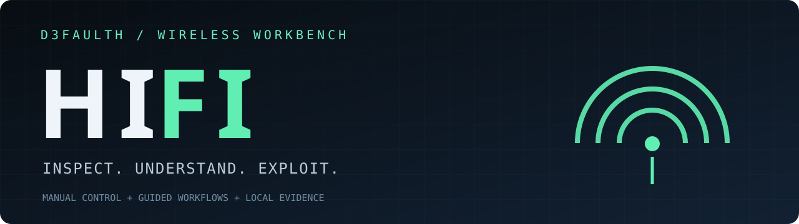

<div align="center">
  
  <p><strong>An interactive wireless Exploit toolkit with an integrated engine.</strong></p>
  <p>Python 3.10+ · Linux · GPL-2.0-only · 0.3.0 alpha</p>
</div>

**HIFI is the application.** Run `hifi` for its terminal menus, command editor,
wireless workflows, capture analysis, saved evidence and guided next steps.
Its engine ships inside the package; there is no separate engine application to
install or launch. External radio and password-processing backends remain
separate system tools.

**Status:** software-verified alpha. Physical adapter and live radio validation
remain pending. The engine has a pinned tagged baseline; its provenance,
modifications and inherited limitations are recorded in [credits](CREDITS.md).

## Install and run

From your cloned or extracted project on Kali/Debian:

```bash
sudo apt install pipx
pipx ensurepath
pipx install .
```

Open a new terminal if `pipx ensurepath` changed your PATH, then run:

```bash
hifi
```

For workflows that need elevated radio access, keep the installed interpreter
by using the full launcher path:

```bash
sudo "$(command -v hifi)"
```

Alternatively, install into a virtual environment:

```bash
python3 -m venv .venv
.venv/bin/python -m pip install .
.venv/bin/hifi
```

The package installs its Python dependencies, chardet and Requests. From the
source folder, `python3 -m hifi --demo` explores the menus without installation,
radio tools, network access or a model. It produces explicitly simulated output.
An 80-column by 24-row Linux terminal is recommended.

The downloadable source package includes `hifi.pyz`. It bundles HIFI's Python
source and licenses, but not third-party Python dependencies or Linux binaries.
Its demo and help work without those dependencies; install the package for normal
operation or make its declared dependencies available to the zipapp interpreter.

## Included features

| Capability | Behavior |
| --- | --- |
| Full HIFI Exploit | Integrated discovery, target selection, prompts and wireless workflows |
| WPA/WPA2 | Handshake capture, optional active deauthentication and dictionary recovery |
| WPS | PIN, Pixie-Dust and supported NULL PIN workflows through Reaver/Bully |
| PMKID | Capture, conversion and password recovery through supported backends |
| WEP | Retained replay, fragmentation, chop-chop and other baseline methods |
| Engine options | All 113 baseline option names and aliases retained; full help in the menu |
| Manual control | Editable engine arguments, analysis filters, file paths and diagnostic commands |
| Capture-only profiles | Separate bounded passive/active profiles, selected BSSID/interface/channel |
| Capture inspector | Metadata, EAPOL and disconnect-frame views; offline wordlist Exploit |
| Diagnostics | Adapter capabilities, interface state, radio blocks and backend inventory |
| Guided suggestions | Evidence-based rules and optional local Ollama explanation |
| Sessions | Private saved arguments, working directory, notes, history and terminal-output tail |
| Reports | HTML/JSON, with sensitive evidence omitted by default |

Recovery depends on network configuration, capture quality, dictionary candidates,
hardware and installed backends. A selector for WPA3/OWE is not a general recovery
method. Unimplemented legacy placeholders are not advertised as working features.
HIFI does not claim to outperform its upstream baseline.

## Terminal workflow

1. Open **Adapter diagnostics** and review dependencies.
2. Choose **HIFI Exploit → Full HIFI Exploit**.
3. Edit the engine command if needed, review it and run.
4. Select targets and respond to engine prompts. Ctrl+C reaches the current
   workflow; exit it to return to the HIFI menu.
5. Review history, inspect captures, add notes and export a report.

HIFI menu controls: arrows or `j/k`, Enter to select, Escape or `q` to return.
The editor supports Home/End, arrows, Backspace/Delete and Ctrl+U. Result views
support Page Up/Page Down. During the engine workflow, keys belong to the engine;
Escape is not a HIFI cancellation shortcut there.

Full Exploit mode uses its own target selection and timing. The scope/duration
shown in HIFI applies to its separate **capture-only** profiles. Those profiles
disable WPS, PMKID and cracking during capture; the full engine does not inject
those restrictions. Passive profiles also disable deauthentication.

## Commands

```bash
hifi --help
hifi --version
hifi doctor
hifi --demo
hifi engine --help
hifi engine --help -v
hifi exploit
hifi exploit --run
hifi --session SESSION_ID exploit
hifi --session SESSION_ID suggest
hifi inspect /absolute/path/capture.pcapng --view eapol
hifi --session SESSION_ID report --output summary.html
```

`hifi engine` is the direct engine entry point. Its flags follow `engine`.
`hifi exploit` adds command preview, a private workspace and HIFI history; its
engine flags follow `--`. Bare `hifi` opens the interactive menus.

See [usage](docs/USAGE.md) for saved arguments, directories and capture profiles.

## System tools and hardware

Install the backends needed for the workflows you use. A Kali starting set is:

```bash
sudo apt update
sudo apt install iw iproute2 rfkill usbutils network-manager ieee-data tshark wireshark-common aircrack-ng reaver bully pixiewps hcxtools hcxdumptool hashcat macchanger
hifi doctor
```

Some optional backends vary by distribution. `hifi doctor` lists binaries it can
find. Supply your own dictionary using the engine's `--dict` option; the package
does not ship a password list or silently download one. Vendor lookup uses the
system IEEE database or an explicitly requested update.

Live operations require a supported Wi-Fi adapter and suitable privileges.
In a VM, pass through a USB Wi-Fi adapter; virtual Ethernet does not provide
802.11 monitor frames. The standalone dumpcap profile needs an existing monitor
interface on the selected channel. The engine can manage monitor mode itself.
After a forced stop, verify interface state; terminal restoration does not imply
radio-interface restoration.

## Data and privacy

State defaults to `$XDG_STATE_HOME/d3faulth-hifi` or
`~/.local/state/d3faulth-hifi`; `--home` overrides it. New session directories are
0700 and JSON/reports are 0600. A session's `engine` subdirectory holds its native
files unless you choose an existing workspace. Relative engine file arguments
resolve in that workspace. Absolute capture and dictionary paths avoid ambiguity.

Sessions retain about 512 KiB of terminal output per command. Engine output is
rendered directly while it runs and sanitized before storage. It may include
credentials. Files are private, not encrypted. Existing workspaces retain their
permissions; new engine files inherit umask 077.

Summary exports omit identifiers, arguments, paths, notes and raw output.
Full exports include sensitive evidence. Nothing is uploaded by report export.
Ollama explanations send recent evidence to localhost only when requested; use a
local model if it must stay local. Model output is never executed.

Session resume restores context and files, not running processes. Old session
settings migrate; historical evidence retains its original contents.

## Development and license

```bash
python3 -m pip install .
python3 -m unittest discover -s tests -v
python3 -m compileall -q hifi
python3 scripts/build_release.py
```

See [validation](docs/VALIDATION.md), [architecture](docs/ARCHITECTURE.md),
[contributing](CONTRIBUTING.md), [changelog](CHANGELOG.md),
[license](LICENSE) and [source credits](CREDITS.md). The combined distribution is
GPL-2.0-only; original notices are retained. Source archives contain the complete
bundled engine source.

Use wireless Exploit workflows on equipment and networks you are authorized to assess.
